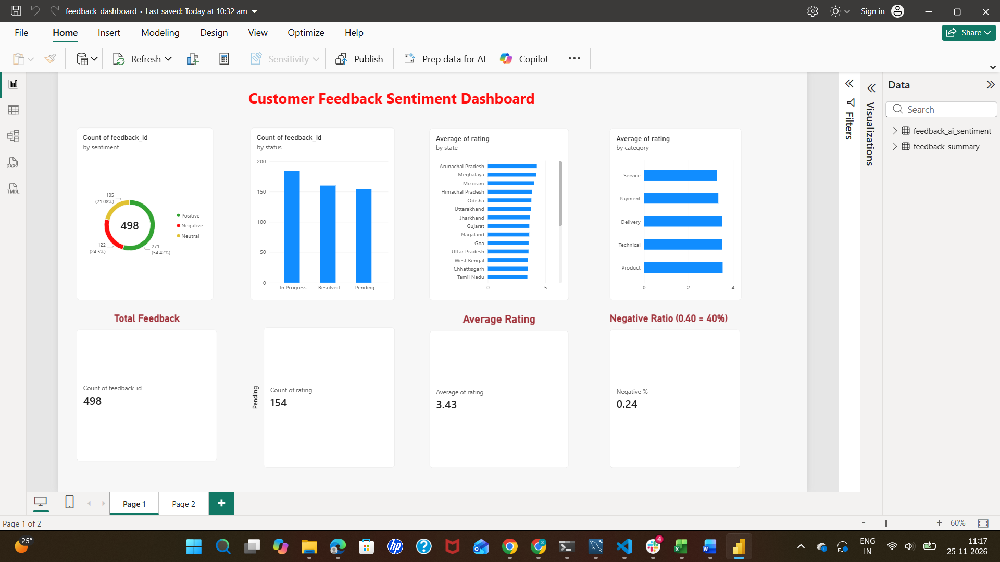
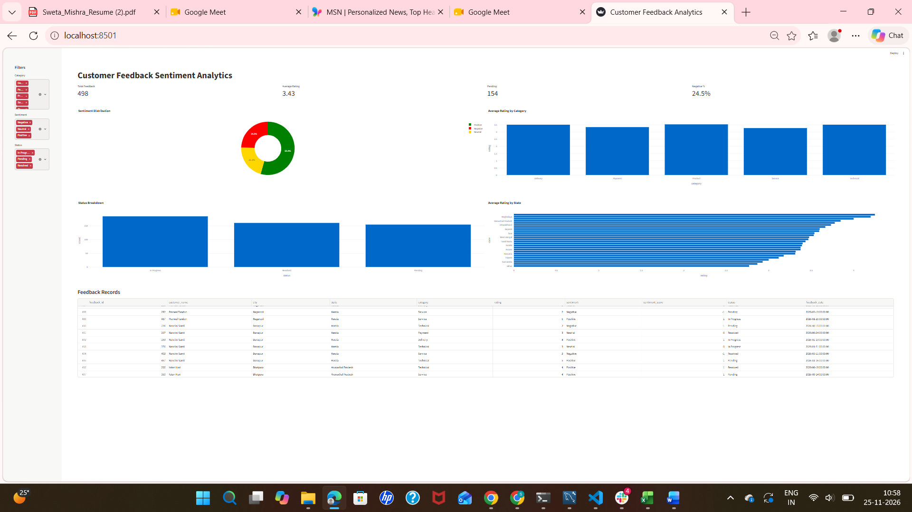

# Customer Feedback Sentiment Analytics

An end-to-end data project that generates customer feedback data, cleans and loads it into MySQL, scores sentiment with NLP (VADER), and presents insights through a Power BI dashboard and a Streamlit web app.

## Architecture

```
Faker (synthetic data) -> Python ETL (clean + validate) -> MySQL
        -> VADER NLP sentiment (compared with rating-based sentiment)
        -> Power BI dashboard (2 pages) + Streamlit app (2 tabs)
```

## Tech Stack

- **Database:** MySQL (schema, joins, group by, views)
- **Python:** pandas, Faker, mysql-connector-python, vaderSentiment, python-dotenv
- **BI:** Power BI Desktop
- **Web app:** Streamlit, Plotly

## Project Structure

```
customer-feedback-analysis/
├── sql/
│   ├── schema.sql
│   └── sql
       ├──analysis_queries.sql

├── screenshots/
├── generate_data.py         # ETL: generate, clean, load into MySQL
├── sentiment_analysis.py    # validation + VADER sentiment + comparison
├── export_summary.py        # exports feedback_summary view to CSV
├── app.py                   # Streamlit app (Overview + AI vs Rating tabs)
├── feedback_dashboard.pbix  # Power BI dashboard
├── .env.example
└── README.md
```

## What It Does

1. **ETL:** generates 100 customers and 500 feedback records with Faker, removes invalid ratings, empty text and duplicates (2 rows removed), then bulk-loads 498 rows into MySQL.
2. **Data validation:** checks missing values, duplicate IDs, invalid ratings, empty text and extra spaces before analysis.
3. **Sentiment:** rating-based sentiment (4-5 Positive, 3 Neutral, 1-2 Negative) compared with VADER sentiment computed from the feedback text.
4. **Power BI:** Page 1 (overview KPIs and charts) and Page 2 (AI vs rating comparison with mismatch table).
5. **Streamlit:** interactive app with sidebar filters, KPI cards, charts, and an "AI vs Rating Sentiment" tab.

## Key Findings

- 498 feedback records across 100 customers
- Sentiment (rating-based): 54.4% positive, 21.1% neutral, 24.5% negative
- Average rating: 3.43 / 5
- 154 feedback items are still pending
- Rating-based and VADER sentiment agree on only about 54% of records

## Limitations

- The data is **synthetic** (Faker + fixed text templates), so findings describe the generated data, not real customers.
- VADER is a general-purpose, pre-trained lexicon model (not trained by me). It struggles with complaint-style text such as "Payment was deducted but order was not placed", which it often scores as Neutral. This explains much of the mismatch.

## Setup

1. Install dependencies:
   ```
   python -m pip install pandas mysql-connector-python faker vaderSentiment python-dotenv streamlit plotly
   ```
2. Create the database, tables and view by running `sql/schema.sql` in MySQL.
3. Copy `.env.example` to `.env` and fill in your MySQL credentials.
4. Run:
   ```
   python generate_data.py        # warning: truncates existing tables
   python sentiment_analysis.py
   python export_summary.py
   python -m streamlit run app.py
   ```
5. After loading data, fill rating-based sentiment in MySQL:
   ```sql
   UPDATE feedback
   SET sentiment = CASE WHEN rating >= 4 THEN 'Positive' WHEN rating = 3 THEN 'Neutral' ELSE 'Negative' END,
       sentiment_score = CASE WHEN rating >= 4 THEN 1 WHEN rating = 3 THEN 0 ELSE -1 END;
   ```
6. Open `feedback_dashboard.pbix` in Power BI Desktop and point the CSV sources to your local files.

## Screenshots





## Future Improvements

- Upload exports to AWS S3
- Containerise with Docker
- Schedule the pipeline (Airflow or cron)
- Train or fine-tune a sentiment model on domain-specific complaint text
